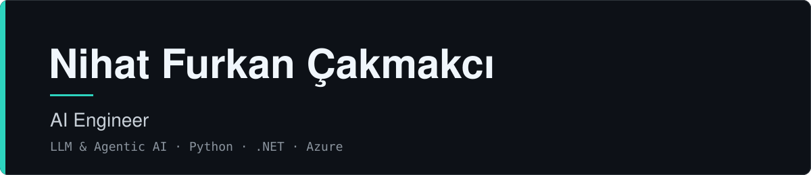

---

## 👋 About

I build **LLM-powered applications and agentic AI systems**, and I take them from proof of concept to production. My main project is a written and voice AI assistant that lets business users query live operational data in natural language. The model decides which tool to call and with what parameters, but it never touches the database directly and never makes up numbers.

I follow new models and tools closely, test them with quick PoCs, and keep what actually works.

## 🚀 What I Work On

| Area | What I do |
|---|---|
| 🤖 **Agentic AI** | Claude tool calling over whitelisted, optimized functions instead of free-form Text-to-SQL, so hallucination and SQL injection risks are closed structurally |
| 🎙️ **Voice AI** | Real-time voice assistant with ElevenLabs Agents: ASR/TTS, turn-taking, wake-word activation, signed URLs and HMAC-verified webhooks |
| 📚 **RAG & Context Engineering** | Domain knowledge layers, system prompt design, prompt caching, multi-model routing |
| 🔐 **Secure multi-tenant backends** | PostgreSQL Row-Level Security, JWT with refresh-token rotation, argon2id |
| ⚡ **Performance** | ClickHouse sidecar for analytics took query time from **12.8 s to 0.25 s (~50x)** |
| ✅ **Evaluation & observability** | 60 automated isolation/role tests, a 140-question eval bank for tool-calling accuracy, promptfoo · Langfuse · Sentry |

## 🛠️ Tech Stack

**Languages & Backend**

**AI / ML**

**Data, Infra & Tooling**

## 📈 Side Project: Crypto Analysis & Forecasting System

An ensemble forecasting system that combines **Temporal Fusion Transformer**, **FinBERT-BiLSTM** (sentiment) and **XGBoost**, with a local **Ollama** LLM layer for market commentary, **TimescaleDB** for time-series data and a **Next.js** dashboard.

## 🎓 Education & Community

- 🎓 B.Sc. Computer Engineering, Isparta University of Applied Sciences (expected 2027). Coursework: Generative AI, Agentic AI
- 👥 **President**, Engineering Thinking Community: leading a 12-person board and 500+ members, organizing coding competitions, robotics contests and technical trips
- 📜 Microsoft Learn: ASP.NET Core Web API · AZ-900 · Azure AI path (in progress)

## 📬 Let's Connect

I'm open to AI engineering internships and roles where I can build and ship LLM and agentic systems.

📧 [cakmakcinihatfurkan@gmail.com](mailto:cakmakcinihatfurkan@gmail.com) · 💼 [LinkedIn](https://linkedin.com/in/nihatfurkancakmakci)

